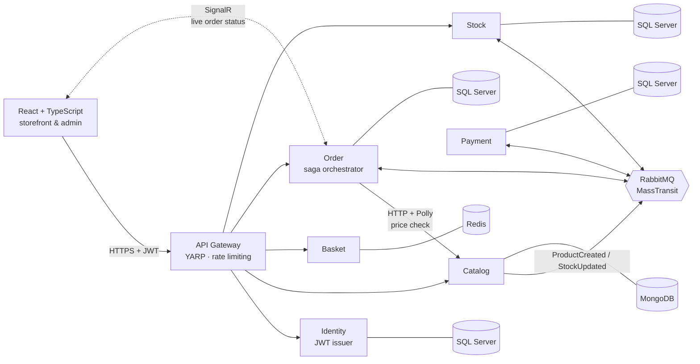
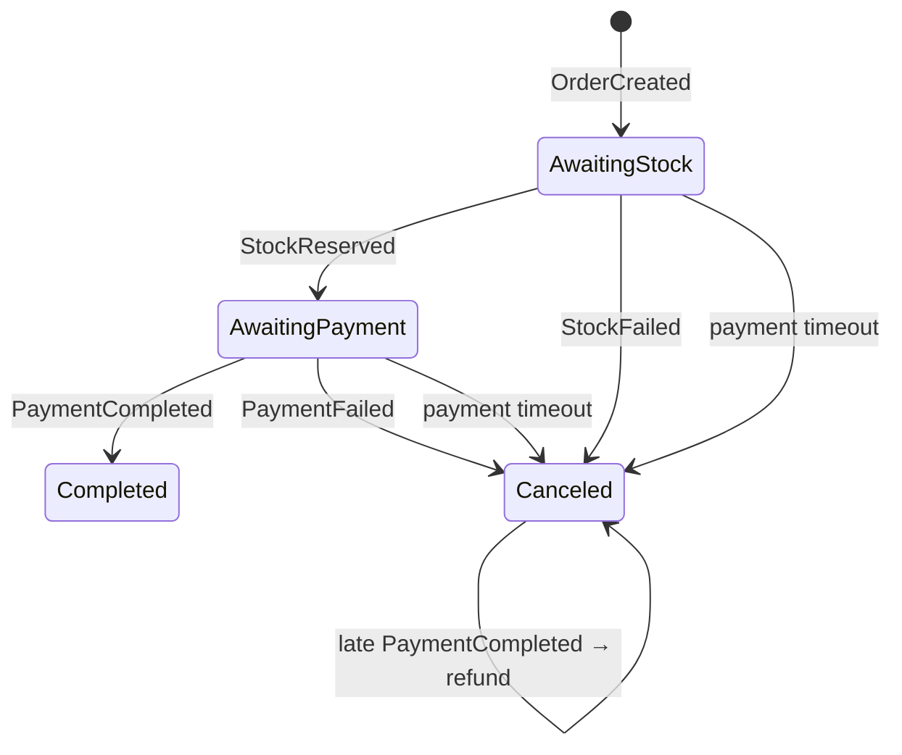

# E-Commerce Microservices

[](https://github.com/emir1958/EticaretMicroservice/actions/workflows/ci.yml)

**English** | [Türkçe](README.tr.md)

An e-commerce platform built as a set of .NET 8 microservices with a React + TypeScript storefront and admin panel.
The core of the project is the order flow: a distributed transaction across the Order, Stock and Payment services,
coordinated by a saga and kept consistent with the transactional outbox pattern, including timeouts, late payments
and automatic refunds.

## Architecture



| Service | Responsibility | Storage |
|---|---|---|
| **Gateway** | Single entry point (YARP), rate limiting, CORS, health dashboard | — |
| **Identity** | Registration, login, RS256 JWT issuing (role-based: `Admin`, `User`), refresh-token cookie, JWKS | SQL Server |
| **Catalog** | Products; publishes product and stock events | MongoDB |
| **Basket** | Per-user basket (the guest basket is merged into it on login) | Redis |
| **Order** | Orders (Clean Architecture + CQRS), the order saga, live status via SignalR | SQL Server |
| **Stock** | Stock levels and reservations | SQL Server |
| **Payment** | Charges and refunds (pluggable provider; iyzico integration planned) | SQL Server |

Services with a public API validate the JWT themselves, so the gateway is not the only line of defence.
Only Identity holds the signing (private) key; every other service verifies tokens with the public key it fetches
from Identity's JWKS endpoint, so a compromised service cannot mint tokens.
Payment has no public API: it only consumes messages from the bus.

## The order flow



1. The client posts the basket with an `Idempotency-Key`. Order re-validates every price against Catalog: the client's prices are never trusted.
2. The order and `OrderCreatedEvent` are written **in one transaction** (transactional outbox). Stock reserves the items, Payment charges the card.
3. The saga (MassTransit state machine) completes or cancels the order and notifies the customer over SignalR.
4. A payment timeout is scheduled with RabbitMQ's delayed exchange. If a payment arrives **after** the order was canceled, the saga issues a refund. The refund is recorded on the order and shown to the customer.
5. Every step is written to the order's history and displayed as a timeline on the order page.

## Engineering highlights

**Reliability and consistency**
- **Saga orchestration** with an explicit decision for every state/event pair, including duplicates and out-of-order events (for example, payment arriving before the stock result).
- **Transactional outbox and inbox** (MassTransit + EF Core) in Order, Stock and Payment: no lost or duplicated messages, no "saved but not published" states.
- **Idempotency** at every level: an `Idempotency-Key` filter on order creation, idempotent consumers, refunds guarded by `UPDLOCK`.
- **Concurrency**: the saga uses pessimistic row locks (an earlier optimistic setup caused SQL deadlocks under concurrent events). Stock is reserved with a single conditional `UPDATE`, so it can never go negative.
- **Timeout safety net**: a background sweeper re-triggers timeouts whose delayed message was lost.
- **Resilience**: Polly (standard resilience handler) on the Order → Catalog HTTP call; retries and dead-letter queues on the bus.

**Authentication**
- Short-lived access tokens (15 min, RS256) live only in the browser's memory. The session is kept alive by a **refresh token**
  in an `HttpOnly; SameSite=Strict` cookie (path `/api/auth`). It is a signed JWT with a different audience (so it cannot be used
  as an access token) and carries the user's `TokenVersion`; signing out bumps that version, which invalidates every refresh token
  of the user without storing anything per token. Trade-off: no per-device sign-out and no replay detection.
- Rate limits are per user / per IP at the gateway.

**Domain and API design**
- The Order service follows **Clean Architecture** (Domain / Application / Infrastructure / WebApi) with **CQRS via MediatR** and **FluentValidation**.
- A rich domain model: state changes go through aggregate methods, which also append the history entry, so status and history cannot diverge.
- Validation mirrors the database constraints, so invalid input returns `400` instead of failing at SQL with `500`.

**Frontend (React 19 + TypeScript, strict)**
- Feature-based structure with documented dependency rules ([ARCHITECTURE.md](src/Clients/ecommerce-ui/ARCHITECTURE.md)).
- Typed API layer, a race-condition-safe `useAsync` hook, guest/user basket merging, stock-aware cart, live order status over SignalR.

**Testing and delivery**
- Unit tests plus integration tests against **real SQL Server via Testcontainers**: saga transitions, timeouts, concurrency, refunds.
- **GitHub Actions** CI runs the backend and frontend jobs; `master` is protected and requires green checks.
- **Observability**: OpenTelemetry traces and logs, viewable in the Aspire dashboard.

## Tech stack

| Area | Technologies |
|---|---|
| Backend | .NET 8, ASP.NET Core, EF Core 8, MassTransit 8, MediatR, FluentValidation, SignalR, YARP |
| Data and messaging | SQL Server, MongoDB, Redis, RabbitMQ (delayed message exchange) |
| Frontend | React 19, TypeScript, Vite, React Router, CSS Modules |
| Testing | xUnit, FluentAssertions, Moq, Testcontainers, MassTransit test harness |
| DevOps | Docker Compose, GitHub Actions, OpenTelemetry, Aspire dashboard |

## Running locally

**Requirements:** Docker, Node.js 24 (for the frontend), .NET 8 SDK (only to run the tests).

```bash
# 1. Configuration: copy the template and fill in the passwords and the JWT key
cp .env.example .env

# 2. Backend: all services and infrastructure (databases are migrated on startup)
docker compose up -d --build

# 3. Frontend
cd src/Clients/ecommerce-ui
npm ci
npm run dev        # http://localhost:5173
```

| URL | |
|---|---|
| http://localhost:5173 | Storefront and admin panel (`/admin`, sign in with `ADMIN_SEED_EMAIL` / `ADMIN_SEED_PASSWORD`) |
| http://localhost:5000 | API gateway |
| http://localhost:5000/health-dashboard | Service health |
| http://localhost:18888 | Aspire dashboard (traces, logs) |
| http://localhost:15672 | RabbitMQ management |

**Sample data:** set `SEED_SAMPLE_DATA=true` in `.env` and the services add sample products, customers and orders spread over
the last 60 days, once, on startup. Existing records are never modified. Sample customers use `@ornek.test` e-mails and cannot
log in; sample orders do not go through the saga. The admin *System status* page shows sample and real record counts separately.

Payments are simulated. Cards ending in `0000` (insufficient funds) or `9999` (bank offline) trigger the payment-failure path.

## Tests

```bash
dotnet test tests/EticaretMicroservice.UnitTests
dotnet test tests/EticaretMicroservice.IntegrationTests          # Order: saga, timeouts, concurrency
dotnet test tests/EticaretMicroservice.Stock.IntegrationTests
dotnet test tests/EticaretMicroservice.Payment.IntegrationTests
```

Integration tests start SQL Server in a container, so Docker must be running.

## Known limitations

These are deliberate trade-offs, documented rather than hidden:
- **SignalR notifications are sent before the saga transaction commits.** If the commit fails, the customer may see a status that is retried and confirmed later. The fix is to publish the notification through the outbox; it was deferred because the practical impact is low.
- **SignalR runs without a backplane**, which is fine for a single Order instance; scaling out requires Redis.
- **Payments use a simulated provider.** The integration with iyzico (hosted checkout form, so card data never touches the server) is the next milestone.

## Documentation

- [Frontend architecture](src/Clients/ecommerce-ui/ARCHITECTURE.md)
- [Order saga: deployment order and risks](docs/order-saga/step4-deploy-risks.md)
- [Order saga: error queue runbook](docs/order-saga/error-queue-runbook.md)
