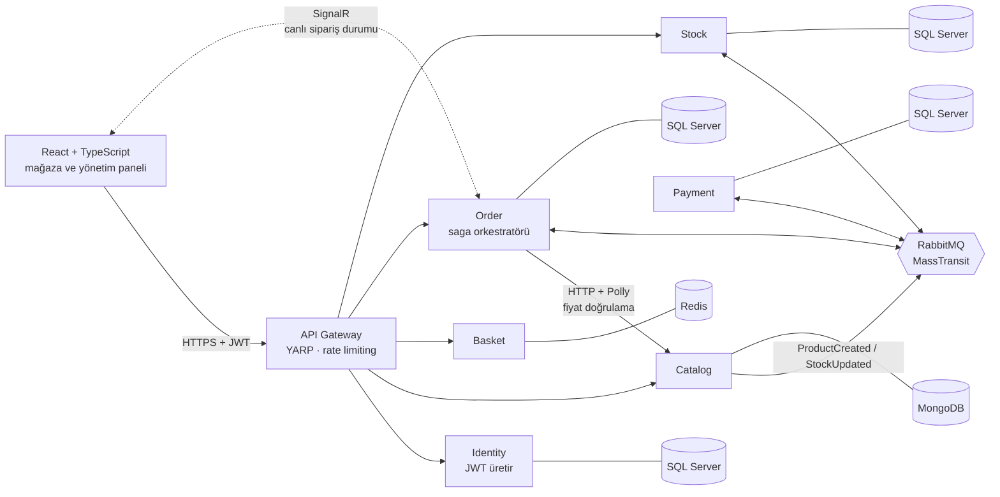
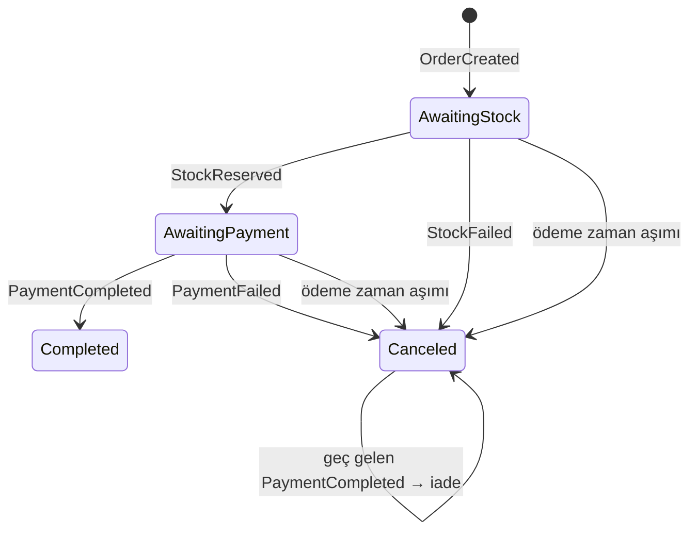

# E-Ticaret Mikroservisleri

[](https://github.com/emir1958/EticaretMicroservice/actions/workflows/ci.yml)

[English](README.md) | **Türkçe**

.NET 8 mikroservisleriyle geliştirilmiş, React + TypeScript mağaza ve yönetim paneline sahip bir e-ticaret platformu.
Projenin merkezinde sipariş akışı var: Order, Stock ve Payment servisleri arasında dağıtık bir işlem. Bu işlemi bir
saga yönetiyor ve transactional outbox deseni tutarlı tutuyor; zaman aşımı, geç gelen ödeme ve otomatik iade de buna dahil.

## Mimari



| Servis | Sorumluluk | Veri |
|---|---|---|
| **Gateway** | Tek giriş noktası (YARP), rate limiting, CORS, sağlık paneli | — |
| **Identity** | Kayıt, giriş, RS256 JWT üretimi (rol tabanlı: `Admin`, `User`), refresh token cookie'si, JWKS | SQL Server |
| **Catalog** | Ürünler; ürün ve stok event'lerini yayınlar | MongoDB |
| **Basket** | Kullanıcı sepeti (girişte misafir sepetiyle birleştirilir) | Redis |
| **Order** | Siparişler (Clean Architecture + CQRS), sipariş saga'sı, SignalR ile canlı durum | SQL Server |
| **Stock** | Stok seviyeleri ve rezervasyonlar | SQL Server |
| **Payment** | Ödeme ve iade (sağlayıcı değiştirilebilir; iyzico entegrasyonu planlı) | SQL Server |

Dışarıya API açan servisler JWT'yi kendileri doğrular, yani güvenlik yalnızca gateway'e bağlı değildir.
İmza (özel) anahtarı yalnızca Identity'dedir; diğer servisler token'ı Identity'nin JWKS uç noktasından aldıkları genel anahtarla
doğrular, bu yüzden ele geçirilen bir servis token üretemez.
Payment'ın dışarıya açık bir API'si yoktur; yalnızca bus'tan gelen mesajları işler.

## Sipariş akışı



1. İstemci sepeti bir `Idempotency-Key` ile gönderir. Order her fiyatı Catalog'dan yeniden doğrular; istemcinin gönderdiği fiyata asla güvenilmez.
2. Sipariş ve `OrderCreatedEvent` **tek bir transaction'da** yazılır (transactional outbox). Stock ürünleri rezerve eder, Payment kartı çeker.
3. Saga (MassTransit state machine) siparişi tamamlar ya da iptal eder ve müşteriyi SignalR ile bilgilendirir.
4. Ödeme zaman aşımı RabbitMQ'nun delayed exchange'i ile zamanlanır. Sipariş iptal edildikten **sonra** ödeme gelirse saga iade başlatır; iade siparişe kaydedilir ve müşteriye gösterilir.
5. Her adım siparişin geçmişine yazılır ve sipariş sayfasında zaman çizelgesi olarak gösterilir.

## Öne çıkan mühendislik kararları

**Güvenilirlik ve tutarlılık**
- **Saga orkestrasyonu:** her durum/event çifti için açık bir karar var; kopya ve sıra dışı gelen event'ler de dahil (ör. ödemenin stok sonucundan önce gelmesi).
- **Transactional outbox ve inbox** (MassTransit + EF Core): Order, Stock ve Payment'ta mesaj kaybı ya da tekrarı yok, "kaydedildi ama yayınlanmadı" durumu oluşmuyor.
- **Her seviyede idempotency:** sipariş oluşturmada `Idempotency-Key` filtresi, idempotent consumer'lar, `UPDLOCK` ile korunan iade.
- **Eşzamanlılık:**
  - Saga pessimistic satır kilidi kullanıyor; daha önceki optimistic yapı eşzamanlı event'lerde SQL deadlock'una yol açıyordu.
  - Stok tek bir koşullu `UPDATE` ile rezerve ediliyor, bu yüzden asla eksiye düşmüyor.
- **Zaman aşımı için emniyet ağı:** zamanlanmış mesajı kaybolan zaman aşımlarını arka plandaki bir sweeper yeniden tetikliyor.
- **Dayanıklılık:** Order → Catalog HTTP çağrısında Polly (standard resilience handler); bus'ta retry ve dead-letter kuyrukları.

**Kimlik doğrulama**
- Kısa ömürlü access token (15 dk, RS256) yalnızca tarayıcı belleğinde durur. Oturumu, `HttpOnly; SameSite=Strict` cookie'deki
  (yol: `/api/auth`) **refresh token** sürdürür. Farklı `aud` taşıyan imzalı bir JWT'dir (access token olarak kullanılamaz) ve
  kullanıcının `TokenVersion` değerini taşır; çıkışta bu sürüm artar ve token başına bir şey saklamadan kullanıcının tüm refresh
  token'ları geçersiz olur. Takas: cihaz bazında çıkış ve yeniden kullanım (replay) tespiti yok.
- Gateway'de hız sınırları kullanıcı / IP başınadır.

**Domain ve API tasarımı**
- Order servisi **Clean Architecture** (Domain / Application / Infrastructure / WebApi), **MediatR ile CQRS** ve **FluentValidation** kullanıyor.
- Zengin domain modeli: durum değişiklikleri aggregate metotlarından geçiyor ve bu metotlar geçmiş kaydını da ekliyor. Durum ile geçmiş birbirinden ayrışamıyor.
- Validation veritabanı kısıtlarını birebir yansıtıyor; geçersiz girdi SQL'de `500` ile patlamak yerine `400` dönüyor.

**Frontend (React 19 + TypeScript, strict)**
- Feature tabanlı yapı ve belgelenmiş bağımlılık kuralları ([ARCHITECTURE.md](src/Clients/ecommerce-ui/ARCHITECTURE.md)).
- Tiplendirilmiş API katmanı, race condition'a karşı güvenli bir `useAsync` hook'u, misafir/kullanıcı sepeti birleştirme, stoğu hesaba katan sepet, SignalR ile canlı sipariş durumu.

**Test ve teslimat**
- Birim testleri ve **Testcontainers ile gerçek SQL Server** üzerinde çalışan entegrasyon testleri: saga geçişleri, zaman aşımları, eşzamanlılık, iadeler.
- **GitHub Actions** CI backend ve frontend job'larını çalıştırıyor; `master` korumalı ve yeşil kontrol olmadan değişiklik kabul etmiyor.
- **Gözlemlenebilirlik:** OpenTelemetry trace ve log'ları Aspire dashboard'da izlenebiliyor.

## Teknolojiler

| Alan | Teknolojiler |
|---|---|
| Backend | .NET 8, ASP.NET Core, EF Core 8, MassTransit 8, MediatR, FluentValidation, SignalR, YARP |
| Veri ve mesajlaşma | SQL Server, MongoDB, Redis, RabbitMQ (delayed message exchange) |
| Frontend | React 19, TypeScript, Vite, React Router, CSS Modules |
| Test | xUnit, FluentAssertions, Moq, Testcontainers, MassTransit test harness |
| DevOps | Docker Compose, GitHub Actions, OpenTelemetry, Aspire dashboard |

## Lokal çalıştırma

**Gereksinimler:** Docker, Node.js 24 (frontend için), .NET 8 SDK (yalnızca testleri çalıştırmak için).

```bash
# 1. Yapılandırma: şablonu kopyalayıp şifreleri ve JWT anahtarını doldurun
cp .env.example .env

# 2. Backend: tüm servisler ve altyapı (veritabanları açılışta migrate edilir)
docker compose up -d --build

# 3. Frontend
cd src/Clients/ecommerce-ui
npm ci
npm run dev        # http://localhost:5173
```

| Adres | |
|---|---|
| http://localhost:5173 | Mağaza ve yönetim paneli (`/admin`; `ADMIN_SEED_EMAIL` / `ADMIN_SEED_PASSWORD` ile giriş) |
| http://localhost:5000 | API gateway |
| http://localhost:5000/health-dashboard | Servis sağlığı |
| http://localhost:18888 | Aspire dashboard (trace, log) |
| http://localhost:15672 | RabbitMQ yönetim paneli |

Ödemeler simüle ediliyor. Sonu `0000` (yetersiz bakiye) veya `9999` (banka erişilemez) olan kartlar ödeme hatası senaryosunu çalıştırır.

**Örnek veri:** `.env` içinde `SEED_SAMPLE_DATA=true` verilirse servisler açılışta bir kez örnek ürün, müşteri ve son 60 güne
yayılmış sipariş ekler (mağaza ve raporlar boş görünmesin diye). Mevcut kayıtlara dokunulmaz. Örnek müşterilerin e-postaları
`@ornek.test` ile biter ve giriş yapamaz; örnek siparişler saga'dan geçmez. Yönetim panelindeki *Sistem durumu* sayfası
örnek ve gerçek kayıt sayılarını ayrı gösterir.

## Testler

```bash
dotnet test tests/EticaretMicroservice.UnitTests
dotnet test tests/EticaretMicroservice.IntegrationTests          # Order: saga, zaman aşımları, eşzamanlılık
dotnet test tests/EticaretMicroservice.Stock.IntegrationTests
dotnet test tests/EticaretMicroservice.Payment.IntegrationTests
```

Entegrasyon testleri SQL Server'ı bir container'da başlattığı için Docker'ın çalışıyor olması gerekir.

## Bilinen sınırlar

Bunlar bilinçli olarak verilmiş ödünler; gizlenmek yerine belgelendi:
- **SignalR bildirimi saga transaction'ı commit edilmeden gönderiliyor.** Commit başarısız olursa müşteri, daha sonra retry ile doğrulanacak bir durumu önceden görebilir. Çözüm bildirimi outbox üzerinden yayınlamak; pratik etkisi düşük olduğu için ertelendi.
- **SignalR backplane olmadan çalışıyor.** Tek bir Order instance'ı için sorun değil; yatay ölçeklemede Redis backplane gerekir.
- **Ödemeler simüle edilmiş bir sağlayıcıyla yapılıyor.** Sıradaki adım iyzico entegrasyonu: kart bilgisinin sunucuya hiç uğramaması için iyzico'nun barındırdığı ödeme formu kullanılacak.

## Dokümantasyon

- [Frontend mimarisi](src/Clients/ecommerce-ui/ARCHITECTURE.md)
- [Order saga: deploy sırası ve riskler](docs/order-saga/step4-deploy-risks.md)
- [Order saga: hata kuyruğu runbook'u](docs/order-saga/error-queue-runbook.md)
